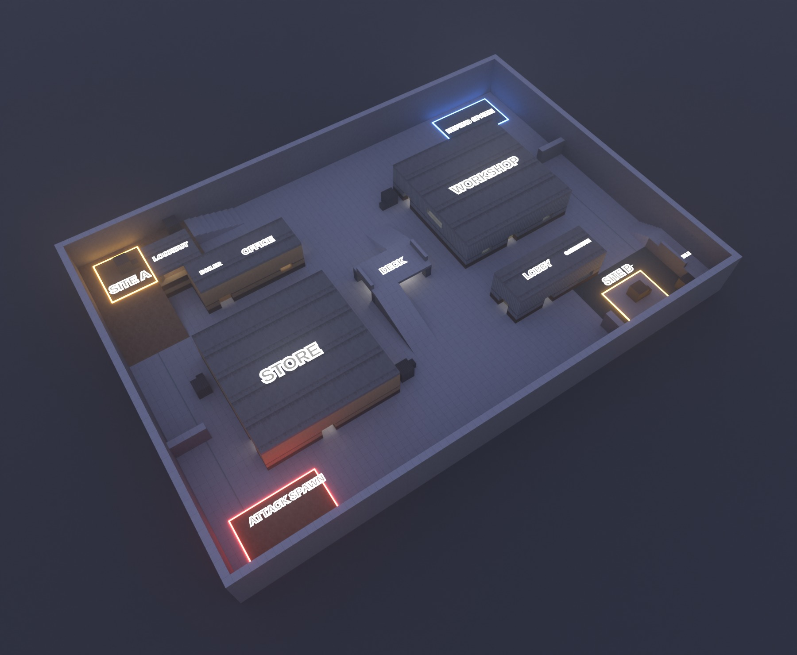
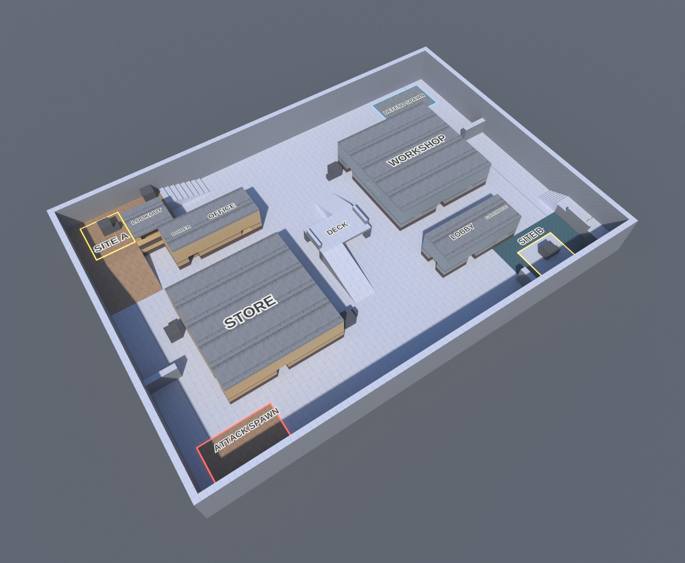
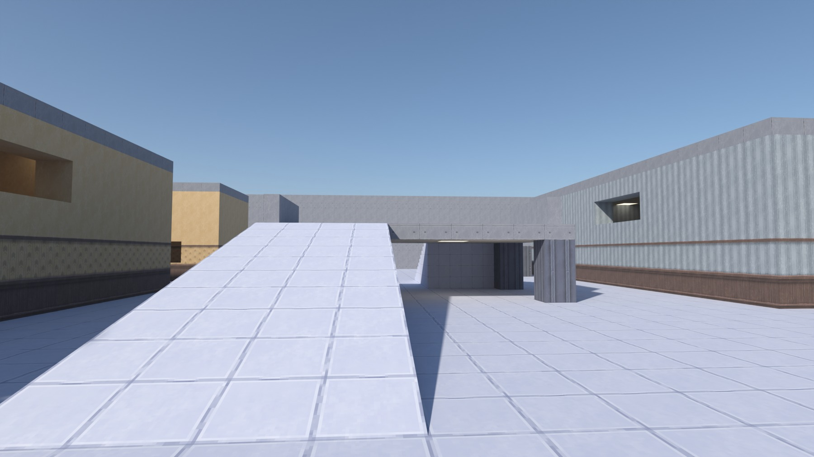
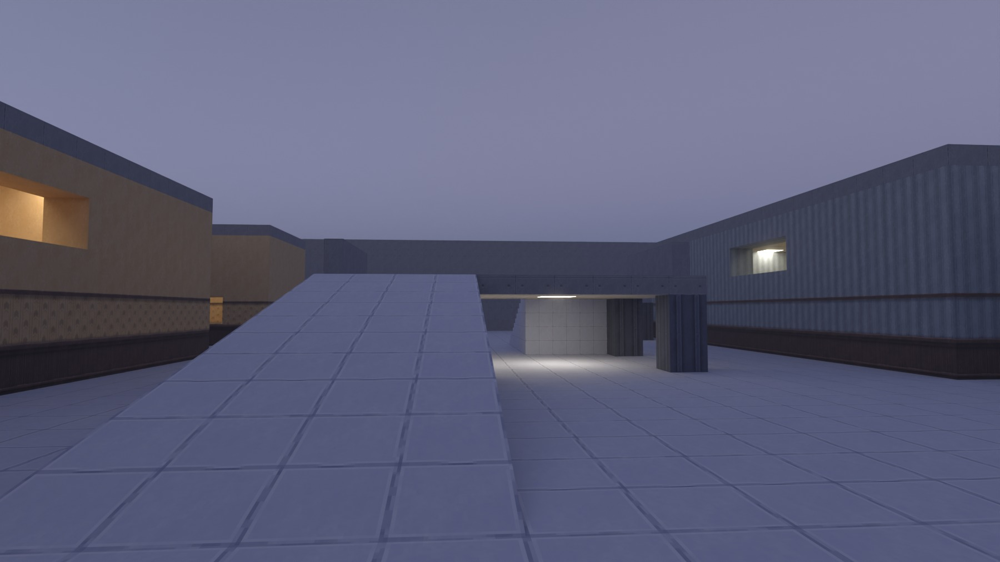
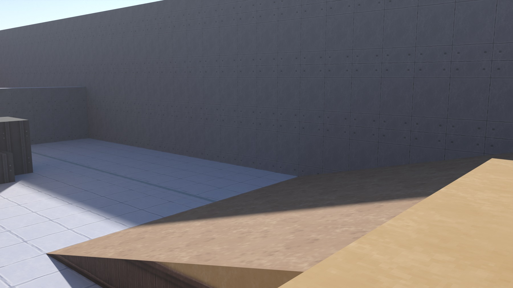
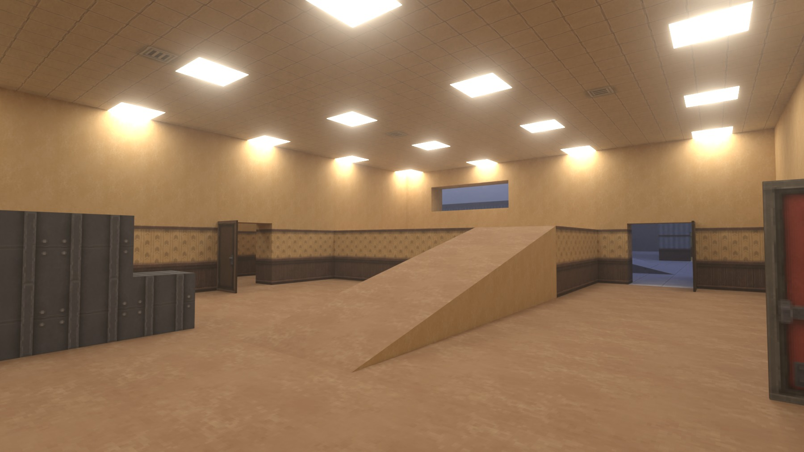
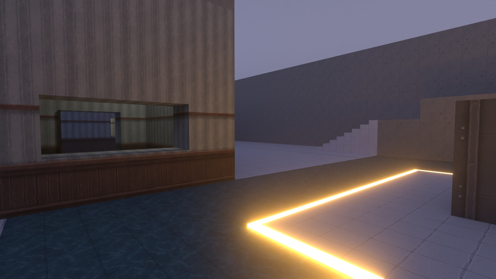
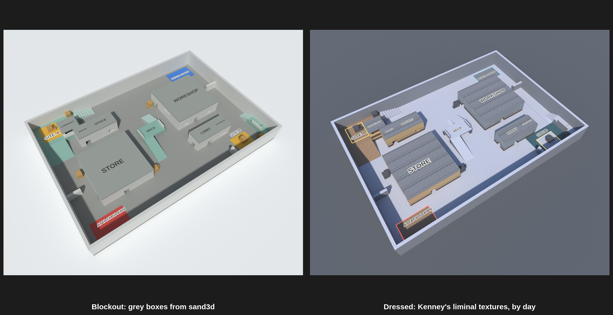

# Liminal Arena

A two-site tactical arena, modelled as code with [sand3d](https://github.com/Sandflow-ai/sand3d):
first as a plain grey blockout, then dressed in pixel textures from Kenney's *Retro Textures
(Liminal)* and exported for game engines. The layout is original: it borrows the genre's grammar
(two sites, a mid, connectors, spawns) and no particular map.

| | |
|---|---|
|  |  |
| The dressed arena at dusk: each pad's outline and the lit windows carry it | The same view by day |

## The map

An 80 × 56 m walled arena on three levels: the ground, a +2 m terrace and walk, and a +2.5 m deck.
The attackers spawn south-west, the defenders north-east. Every height has at least one way up
that can be watched, and every strong position has something that answers it.

| Callout | Where |
|---|---|
| **Site A** | the raised terrace in the north-west, with a Lookout over its ramp |
| **Site B** | the courtyard in the south-east, under a Walk along its east wall |
| **Mid** | a deck on four pillars over an underpass; a ramp from the south, stairs from the north |
| **West lane, East lane** | the strips between each team's hall and its slim building |
| **Store, Pump room, Store loft** | the attackers' hall (south-west) |
| **Workshop, Plant room, Workshop loft** | the defenders' hall (north-east) |
| **Boiler, Office** | the slim building beside the west lane |
| **Lobby, Gatehouse** | its twin beside the east lane |

| Vantage | It holds | Answered by |
|---|---|---|
| V1 Lookout | the A ramp's east half and foot, and the west lane | its door faces the terrace, or vault its 1 m parapet |
| V2 Deck | both passage mouths and both mid courts | the underpass and side strips run beneath its sight |
| V3 Store loft | mid south and the deck | one ramp up, inside the store; the deck sees its window |
| V4 Workshop loft | mid north and the deck | one ramp up, inside the workshop; the deck sees its window |
| V5 Walk | site B and B main | the crate stair jumps onto its south end |
| V6 Gatehouse | a window over B main | the plant crate hides from it; its doors face away |


The plan from above, roofs off. For the same plan as a line drawing, with every vantage's
sightlines cast against the model and drawn, see [the tactics plan](images/arena_tactics.png).

## The look

Nothing moves: every surface is where the blockout has it. What changes is what it is made of.

- **The yard is pool deck.** The arena is a walled basin with lanes along its sides and a flooded
  corner, so it is dressed as a drained pool: pale tiles underfoot everywhere out of doors, a teal
  lane line down the west lane and up the east, and site B's courtyard left under shallow water.
- **The rooms are carpeted** -- red in the attackers' store, pump room, boiler and office, green in
  the defenders' workshop, plant room, lobby and gatehouse -- under yellow wallpaper on one side
  and blue on the other, each above a dark wainscot.
- **Every roof is a suspended ceiling** of 1 m tiles, one lit every 4 m. The lit tiles glow, and
  they are what lights every room.
- **A door stands open in each of the 19 doorways**, every one swinging into a room and never
  across a path. The two spawn-side doors are emergency exits.
- **Each pad is outlined in light**: amber for the sites, red for the attackers' spawn, blue for
  the defenders'.

| | |
|---|---|
|  |  |
| Mid by day, from the south court up the ramp to the deck | The same view at dusk, a loft window lit |
|  |  |
| The west lane: its line underfoot, the ramp up to site A | From the Lookout, over its parapet: that ramp and the lane below |
|  |  |
| Inside the store at dusk, lit only by its ceiling | From the deck: the stairs down to mid north |
|  |  |
| In B main at dusk: the Gatehouse's window, the site pad's outline | From the Walk, over site B's water |



## Two exports

- **`models/arena_blockout.glb`** -- the grey boxes, 181 parts, flat colours. Use it to test the
  layout, or as the collision and greybox reference.
- **`models/liminal/`** -- the same geometry to the millimetre, dressed:

| File | Notes |
|---|---|
| `arena_liminal.glb` | textures embedded, 24 lamps, 750 KB |
| `arena_liminal.fbx` | textures embedded, lamps |
| `obj/arena_liminal.obj` | `.mtl` and its 23 textures beside it (OBJ carries no lamps) |
| `arena_liminal.blend` | the dressed scene, images packed |
| `arena_liminal.json` | spawns, sites, the vantage/counter table and the water, in the axes of `examples/` |

Packed downloads of each are on the [releases](https://github.com/IAFahim/liminal-arena/releases)
page.

## Build, check, render

Needs Python 3.13 (or 3.11). `pip install sand3d` brings Blender's `bpy` module with it; this was
built with sand3d 1.6.3 and Blender 5.2. A GPU speeds up the renders (Cycles falls back to the CPU).

```sh
python examples/arena_blockout.py          # the grey blockout  -> models/arena_blockout.glb
python examples/arena_liminal.py           # the dressed arena  -> models/liminal/*

python tools/check_arena.py models/liminal/arena_liminal.glb   # walk times, ways up, sightlines
python tools/roundtrip.py models/liminal/arena_liminal.fbx models/liminal/obj/arena_liminal.obj \
                           models/liminal/arena_liminal.blend  # the other files import at the right size

python render/render_blockout.py models/arena_blockout.glb images/arena_tactics.png tactics
python render/render_liminal.py models/liminal/arena_liminal.glb images/liminal_plan.png plan
python render/render_liminal.py models/liminal/arena_liminal.glb images/x.jpg aerial dusk
python render/render_liminal.py models/liminal/arena_liminal.glb images/x.jpg eye mid day
```

The two renderers share their cameras and callouts (`render/views.py`), so a grey view and a
dressed one are the same photograph. The dressed ones take `plan`, `aerial`, or one of
`mid lane lookout store deck b walk`, then `day` or `dusk`; add `50 32` on the end for a quick
half-size look. A full-size picture takes about half a minute on a GeForce RTX 3060.

```sh
python tools/package.py 1.0.0 /tmp/liminal-release   # one zip per format, and SHA256SUMS
```

`images/before_after.jpg` is the two aerials set side by side with ImageMagick's `montage`.

## Importing it

- Metres, Y-up, the arena's centre on the origin at ground level. `x` east, `y` north, `z` up in
  the scripts and in `arena_liminal.json`.
- Hierarchy: `Arena` → `Structure`, `Cover`, `Doors`, `Sites`, `Markers`, `Lights`.
- Each part keeps its own pivot, and each door pivots on its hinge.
- `Sites` holds the four pads and two empties, `Spawn_Attack` and `Spawn_Defend`.
- `Markers` holds twelve purple and green plates marking the vantage points and their counters.
  They are design notes, not level geometry: hide the group. `tools/check_arena.py` reads them.
- `Lights` holds 24 point lights under the lit ceiling tiles. They are optional (no loader has to
  support them); delete the group if you light the level yourself.
- The water in site B's courtyard is a texture on the flat floor. `arena_liminal.json` gives its
  rectangle as `water`, for an engine's own splash, reflection or slow step.

## What the renders are

Each dressed picture is Cycles looking at the exported GLB itself: nothing is in the scene that
the file does not hold, apart from the plain under the arena, the sun, the sky and a thin mist. By
day the sun does the lighting. At dusk it hangs below the horizon, and the rooms are lit by their
own ceiling tiles and the pads by their own outlines. The point lamps are hidden in every picture,
because the lit tiles above them already do their work.

## What was verified

`tools/check_arena.py` casts rays against the exported GLB. On both the grey and the textured file:

- every room, pad, marker and high place is walkable from both spawns with no jump or drop;
- all 11 ways up behave as intended (a loft is unreachable without its ramp, the walk without its
  stairs and crates, and so on);
- 39 of 39 sightlines are open or blocked as designed.

The textured file stands on the same 17,649 floor cells as the grey one, so the open doors and the
retiled floor close no route. The FBX, OBJ and `.blend` were each imported again into Blender and
measured 80 × 56 × 8 m with all 23 textures.

Not verified: nothing here has been play-tested, and none of the exports has been opened in a
game engine. Timings are straight-line estimates at 5.5 m/s, and the spawns are not tuned to a
defusal rule (the attackers reach site A about 4.7 s before the defenders, the defenders reach
site B about 1.5 s first).

## Credits and licence

The code and the arena are MIT (see `LICENSE`). The textures in `textures/` are *Retro Textures
Liminal* 1.0 by [Kenney](https://www.kenney.nl), released under CC0 — public domain, credit
appreciated but not required.
