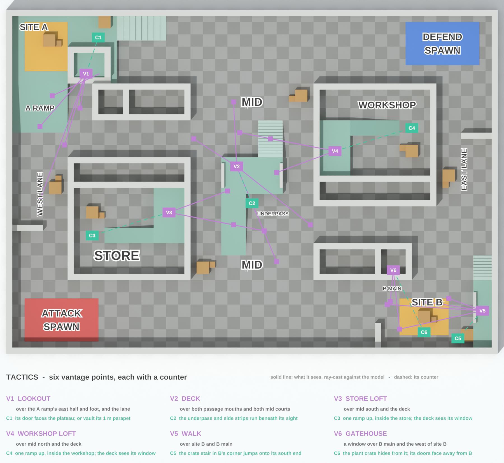
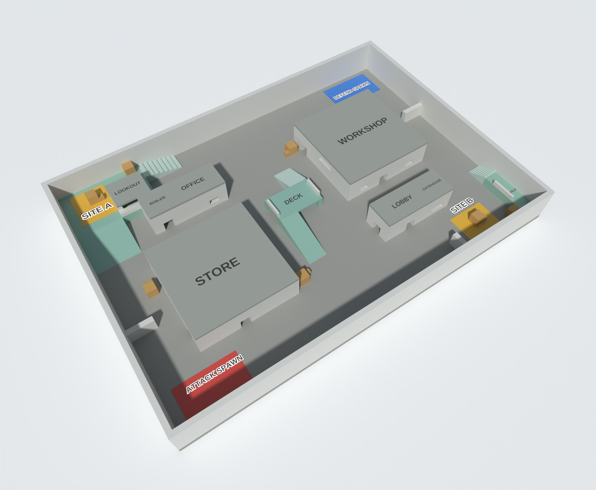
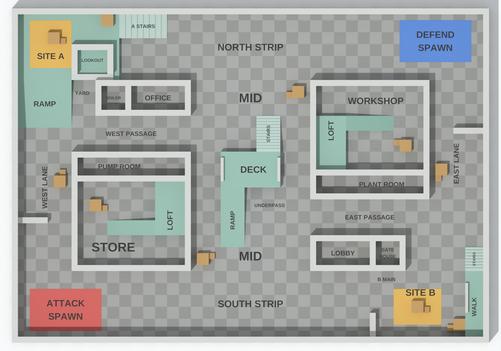
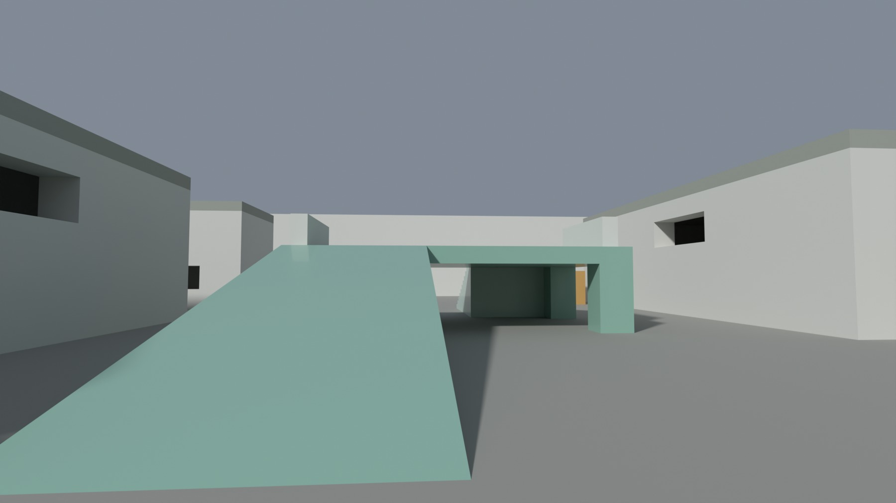
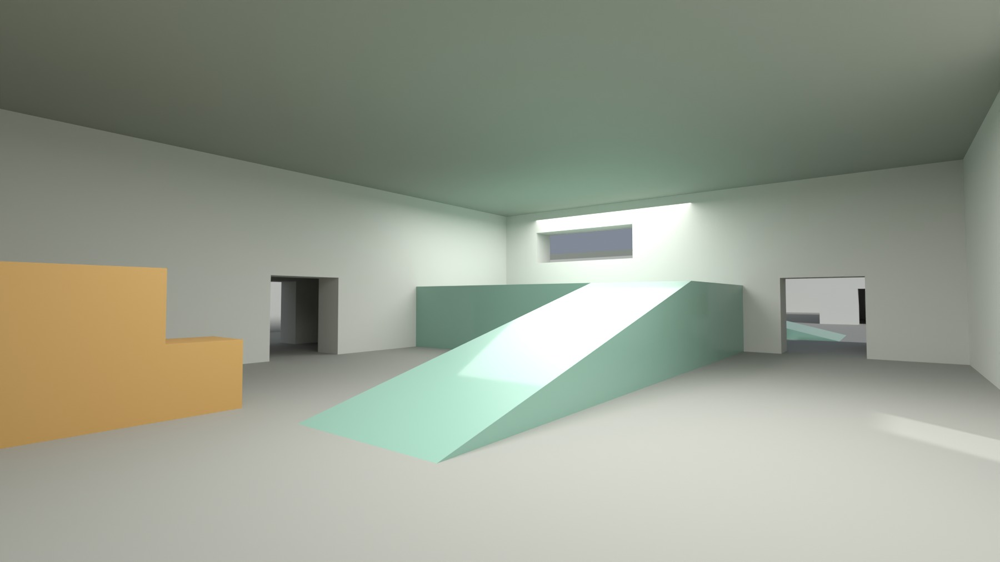
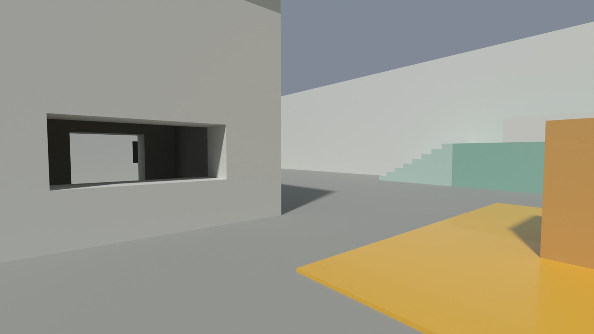
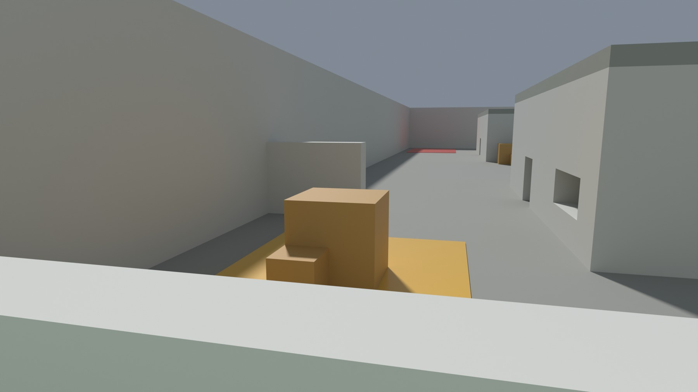

# Liminal Arena

A two-site tactical arena, modelled as code with [sand3d](https://github.com/Sandflow-ai/sand3d):
first as a plain grey blockout, then dressed in pixel textures from Kenney's *Retro Textures
(Liminal)* and exported for game engines. The layout is original: it borrows the genre's grammar
(two sites, a mid, connectors, spawns) and no particular map.

**Status:** the blockout is designed and verified, and the textured arena is exported as GLB, FBX,
OBJ and `.blend`. Renders of the textured arena and the first release are still to do (see the
open issue).

| | |
|---|---|
|  |  |
| Tactics plan: six vantage points, each with a counter | Aerial of the grey blockout |

## The map

An 80 × 56 m walled arena on three levels: the ground, a +2 m terrace and walk, and a +2.5 m deck.
The attackers spawn south-west, the defenders north-east. Every height has at least one way up
that can be watched, and every strong position has something that answers it.

| Callout | Where |
|---|---|
| **Site A** | the raised terrace in the north-west, with a Lookout over its ramp |
| **Site B** | the courtyard in the south-east, under a Walk along its east wall |
| **Mid** | a deck on four pillars over an underpass; a ramp from the south, stairs from the north |
| **West lane, East lane** | the strips between each team's hall and its slim building |
| **Store, Pump room, Store loft** | the attackers' hall (south-west) |
| **Workshop, Plant room, Workshop loft** | the defenders' hall (north-east) |
| **Boiler, Office** | the slim building beside the west lane |
| **Lobby, Gatehouse** | its twin beside the east lane |

| Vantage | It holds | Answered by |
|---|---|---|
| V1 Lookout | the A ramp's east half and foot, and the west lane | its door faces the terrace, or vault its 1 m parapet |
| V2 Deck | both passage mouths and both mid courts | the underpass and side strips run beneath its sight |
| V3 Store loft | mid south and the deck | one ramp up, inside the store; the deck sees its window |
| V4 Workshop loft | mid north and the deck | one ramp up, inside the workshop; the deck sees its window |
| V5 Walk | site B and B main | the crate stair jumps onto its south end |
| V6 Gatehouse | a window over B main | the plant crate hides from it; its doors face away |



## Two exports

- **`models/arena_blockout.glb`** — the grey boxes, 181 parts, flat colours. Use it to test the
  layout, or as the collision and greybox reference.
- **`models/liminal/`** — the same geometry to the millimetre, dressed:

| File | Notes |
|---|---|
| `arena_liminal.glb` | textures embedded, 24 lamps, 740 KB |
| `arena_liminal.fbx` | textures embedded, lamps |
| `obj/arena_liminal.obj` | `.mtl` and its 23 textures beside it (OBJ carries no lamps) |
| `arena_liminal.blend` | the dressed scene, images packed |
| `arena_liminal.json` | spawns, sites, the vantage/counter table, in the axes of `examples/` |

What the dressing adds, and nothing more: a wallpaper panel on the walls (yellow on the
attackers' side, blue on the defenders'), carpet in the rooms (red, green), a suspended ceiling
under every roof with a lit tile every 4 m, a door standing open in each of the 19 doorways, each
pad outlined in light, and site B's courtyard standing in shallow water.






## Build, check, render

Needs Python 3.13 (or 3.11). `pip install sand3d` brings Blender's `bpy` module with it; this was
built with sand3d 1.6.3 and Blender 5.2. A GPU speeds up the renders (Cycles falls back to the CPU).

```sh
python examples/arena_blockout.py          # the grey blockout  -> models/arena_blockout.glb
python examples/arena_liminal.py           # the dressed arena  -> models/liminal/*

python tools/check_arena.py models/liminal/arena_liminal.glb   # walk times, ways up, sightlines
python tools/roundtrip.py models/liminal/arena_liminal.fbx models/liminal/obj/arena_liminal.obj \
                           models/liminal/arena_liminal.blend  # the other files import at the right size

python render/render_blockout.py models/arena_blockout.glb images/arena_tactics.png tactics
python render/render_blockout.py models/arena_blockout.glb images/arena_aerial.jpg aerial
python render/render_blockout.py models/arena_blockout.glb images/arena_mid.jpg eye mid
```

## Importing it

- Metres, Y-up, the arena's centre on the origin at ground level. `x` east, `y` north, `z` up in
  the scripts and in `arena_liminal.json`.
- Hierarchy: `Arena` → `Structure`, `Cover`, `Doors`, `Sites`, `Markers`, `Lights`.
- Each part keeps its own pivot, and each door pivots on its hinge.
- `Sites` holds the four pads and two empties, `Spawn_Attack` and `Spawn_Defend`.
- `Markers` holds twelve purple and green plates marking the vantage points and their counters.
  They are design notes, not level geometry: hide the group.
- `Lights` holds 24 point lights under the lit ceiling tiles. They are optional (no loader has to
  support them); delete the group if you light the level yourself.

## What was verified

`tools/check_arena.py` casts rays against the exported GLB. On both the grey and the textured file:

- every room, pad, marker and high place is walkable from both spawns with no jump or drop;
- all 11 ways up behave as intended (a loft is unreachable without its ramp, the walk without its
  stairs and crates, and so on);
- 39 of 39 sightlines are open or blocked as designed.

The textured file stands on the same 17,649 floor cells as the grey one, so the open doors close
no route. The FBX, OBJ and `.blend` were each imported again and measured 80 × 56 × 8 m with all
23 textures.

Not verified: nothing here has been play-tested. Timings are straight-line estimates at 5.5 m/s,
and the spawns are not tuned to a defusal rule (the attackers reach site A about 4.7 s before the
defenders, the defenders reach site B about 1.5 s first).

## Credits and licence

The code and the arena are MIT (see `LICENSE`). The textures in `textures/` are *Retro Textures
Liminal* 1.0 by [Kenney](https://www.kenney.nl), released under CC0 — public domain, credit
appreciated but not required.
