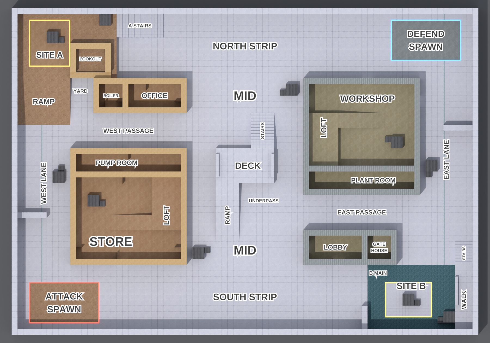
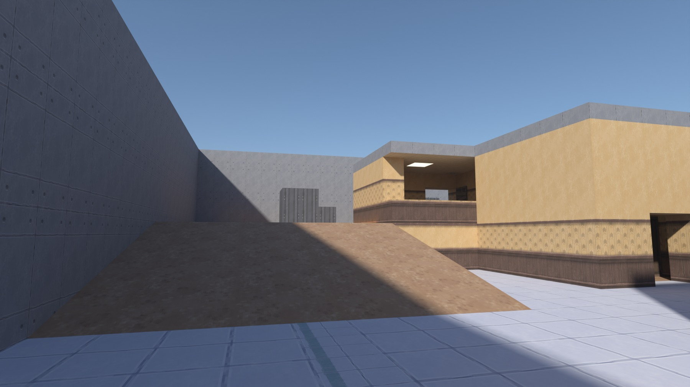
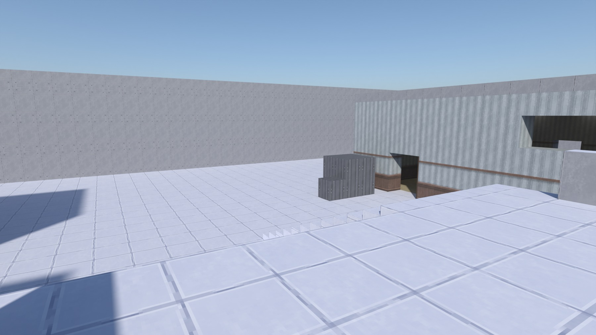
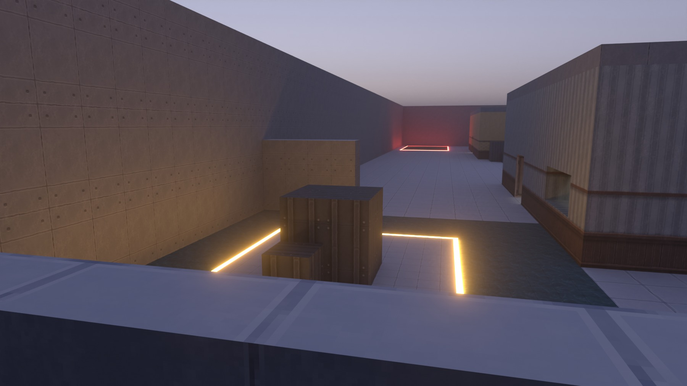
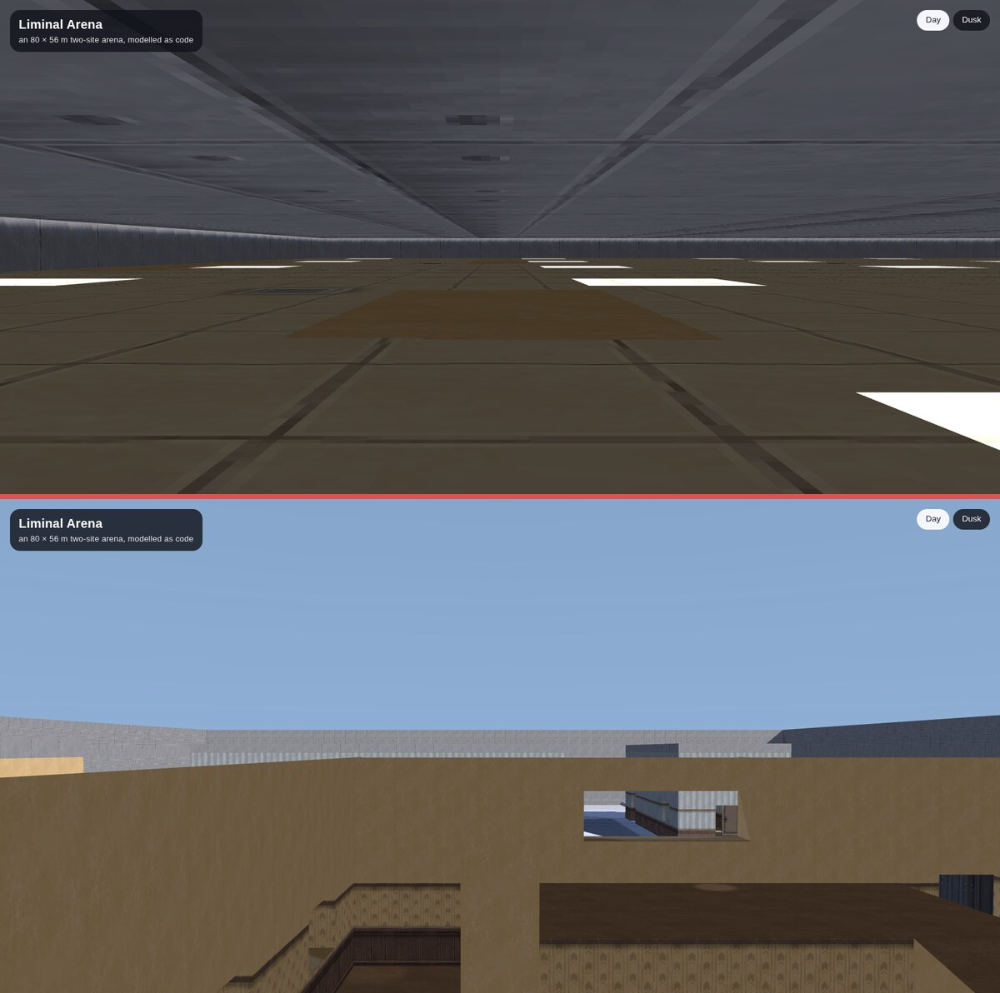

# Liminal Arena

A two-site tactical arena, modelled as code with [sand3d](https://github.com/Sandflow-ai/sand3d):
first as a plain grey blockout, then dressed in pixel textures from Kenney's *Retro Textures
(Liminal)* and exported for game engines. The layout is original: it borrows the genre's grammar
(two sites, a mid, connectors, spawns) and no particular map.

**See it in a browser:** [iafahim.github.io/liminal-arena](https://iafahim.github.io/liminal-arena/) --
the dressed arena to turn under your pointer, by day and at dusk ([how it is made](#in-a-browser)).
The page loads the packed export: 2,461 triangles, 43 draws, one atlas, and no z-fighting.

| | |
|---|---|
|  |  |
| The dressed arena at dusk: each pad's outline and the lit windows carry it | The same view by day |

## The map

An 80 × 56 m walled arena on three levels: the ground, a +2 m terrace and walk, and a +2.5 m deck.
The attackers spawn south-west, the defenders north-east. Every height has at least one way up
that can be watched, and every strong position has something that answers it.

| Callout | Where |
|---|---|
| **Site A** | the raised terrace in the north-west, with a Lookout over its ramp |
| **Site B** | the courtyard in the south-east, under a Walk along its east wall |
| **Mid** | a deck on four pillars over an underpass; a ramp from the south, stairs from the north |
| **West lane, East lane** | the strips between each team's hall and its slim building |
| **Store, Pump room, Store loft** | the attackers' hall (south-west) |
| **Workshop, Plant room, Workshop loft** | the defenders' hall (north-east) |
| **Boiler, Office** | the slim building beside the west lane |
| **Lobby, Gatehouse** | its twin beside the east lane |

| Vantage | It holds | Answered by |
|---|---|---|
| V1 Lookout | the A ramp's east half and foot, and the west lane | its door faces the terrace, or vault its 1 m parapet |
| V2 Deck | both passage mouths and both mid courts | the underpass and side strips run beneath its sight |
| V3 Store loft | mid south and the deck | one ramp up, inside the store; the deck sees its window |
| V4 Workshop loft | mid north and the deck | one ramp up, inside the workshop; the deck sees its window |
| V5 Walk | site B and B main | the crate stair jumps onto its south end |
| V6 Gatehouse | a window over B main | the plant crate hides from it; its doors face away |



The plan from above, roofs off. For the same plan as a line drawing, with every vantage's
sightlines cast against the model and drawn, see [the tactics plan](images/arena_tactics.png).

## The look

Nothing moves: every surface is where the blockout has it. What changes is what it is made of.

- **The yard is pool deck.** The arena is a walled basin with lanes along its sides and a flooded
  corner, so it is dressed as a drained pool: pale tiles underfoot everywhere out of doors, a teal
  lane line down the west lane and up the east, and site B's courtyard left under shallow water.
- **The rooms are carpeted** -- red in the attackers' store, pump room, boiler and office, green in
  the defenders' workshop, plant room, lobby and gatehouse -- under yellow wallpaper on one side
  and blue on the other, each above a dark wainscot.
- **Every roof is a suspended ceiling** of 1 m tiles, one lit every 4 m. The lit tiles glow, and
  they are what lights every room.
- **A door stands open in each of the 19 doorways**, every one swinging into a room and never
  across a path. The two spawn-side doors are emergency exits.
- **Each pad is outlined in light**: amber for the sites, red for the attackers' spawn, blue for
  the defenders'.

| | |
|---|---|
|  |  |
| Mid by day, from the south court up the ramp to the deck | The same view at dusk, a loft window lit |
|  |  |
| The west lane: its line underfoot, the ramp up to site A | From the Lookout, over its parapet: that ramp and the lane below |
|  |  |
| Inside the store at dusk, lit only by its ceiling | From the deck: the stairs down to mid north |
|  |  |
| In B main at dusk: the Gatehouse's window, the site pad's outline | From the Walk, over site B's water |


## Three exports

- **`models/arena_blockout.glb`** -- the grey boxes, 181 parts, flat colours. Use it to test the
  layout, or as the collision and greybox reference.
- **`models/liminal/`** -- the same geometry to the millimetre, dressed:

| File | Notes |
|---|---|
| `arena_liminal.glb` | textures embedded, 24 lamps, 750 KB |
| `arena_liminal.fbx` | textures embedded, lamps |
| `obj/arena_liminal.obj` | `.mtl` and its 23 textures beside it (OBJ carries no lamps) |
| `arena_liminal.blend` | the dressed scene, images packed |
| `arena_liminal.json` | spawns, sites, the vantage/counter table and the water, in the axes of `examples/` |

- **`models/liminal/arena_liminal_packed.glb`** -- the dressed arena packed for a real-time viewer:
  2,461 triangles, 43 draws, one 2048 × 2048 atlas, every material single-sided. The browser page
  loads it. `tools/pack_arena.py` writes it from the dressed arena, so it is never edited by hand
  ([what it does](#packed-for-a-real-time-viewer)). `arena_liminal_packed.png` beside it is the
  atlas on its own, to look at; the GLB holds the same bytes embedded.

Zipped downloads of all three, and a list of checksums, are on the
[releases](https://github.com/IAFahim/liminal-arena/releases) page. v1.1.0 is the first release to
carry the packed one.

## In a browser

**[iafahim.github.io/liminal-arena](https://iafahim.github.io/liminal-arena/)** is GitHub Pages
serving this repository's root. The page is one file, `index.html`, and there is no build step: it
loads `models/liminal/arena_liminal_packed.glb` into [three.js](https://threejs.org/) r187, which is
kept whole in `vendor/three/` (MIT, as three.js is) rather than fetched from a CDN. The **Packed**
and **Source** keys at the top right change the file: Source is the dressed one, every part its own
object. The address follows the keys, so a link can open on either.

- It opens on the aerial. The keys along the bottom glide to the cameras of the pictures above;
  **Day** and **Dusk** cross-fade between the two lightings. Drag to orbit, scroll to zoom.
- The address names the file, a view and a time, so a link can open on one: `#store`, `#dusk`,
  `#lane/dusk`, and `?model=models/liminal/arena_liminal.glb#store` for the dressed file.
- One thing differs from the file, in the browser only. The 24 point lamps are swapped at load for
  downlights as bright as the lit tiles above them, because a browser cannot light a room by its
  ceiling the way Cycles does. The model itself is not touched. (With the dressed file, `Markers`
  is hidden too; the packed file does not carry them.)
- It needs WebGL 2, and draws only when something has changed.
- Edges are smoothed in the page's own buffer, four samples to a pixel, and copied to the canvas;
  the canvas itself does not smooth. The pictures are the same to the pixel. The reason is that a
  canvas which smooths itself and is drawn only on change was found, on one graphics path, to come
  to rest on a frame of its own ([below](#the-first-frame)).

To look at a local copy, serve the repository rather than opening the file, since the page loads
modules: `python -m http.server 8000`, then <http://localhost:8000/>.

### The first frame

The page draws only when something has changed, so the frame it comes to rest on has to be the
right one. In a headless Chromium 155 on a GeForce RTX 3060, put on ANGLE's OpenGL path
(`--use-angle=gl`), it was not always so while the canvas smoothed itself (`antialias: true`). In
16 of 42 loads of this page, and 17 of 42 of the page as first published, the picture it rested on
was not the one it would draw again if asked: in a few of them a bridge and the kiosk under it were
missing, or a shopfront, or with the packed file the whole arena. One more frame made it right, and
it stayed right. The scene was the same in both states (the camera, the meshes in view, the
textures, the programs): the fault is in that graphics path, not in the page. The same pages on the
card's Vulkan path and on a software rasteriser never did it (6 loads, 14 redraws each); nor did a
canvas without smoothing on the OpenGL path.

So the canvas is plain now, and the page smooths in its own buffer. Checked after the change on
that OpenGL path: 28 of 28 loads (14 with each file) rested on the picture they draw again, and on
the Vulkan path 14 of 14. The sixteen views of the page are the same to the pixel as before the
change, on both paths. What was not looked at: a Chromium with a window, on that path or any
other.

## Build, check, render

Needs Python 3.13 (or 3.11). `pip install sand3d` brings Blender's `bpy` module with it; this was
built with sand3d 1.6.3 and Blender 5.2. A GPU speeds up the renders (Cycles falls back to the CPU).

```sh
python examples/arena_blockout.py          # the grey blockout  -> models/arena_blockout.glb
python examples/arena_liminal.py           # the dressed arena  -> models/liminal/*

python tools/check_arena.py models/liminal/arena_liminal.glb   # walk times, ways up, sightlines
python tools/roundtrip.py models/liminal/arena_liminal.fbx models/liminal/obj/arena_liminal.obj \
                           models/liminal/arena_liminal.blend  # import at the right size; no file says where it was written

python render/render_blockout.py models/arena_blockout.glb images/arena_tactics.png tactics
python render/render_liminal.py models/liminal/arena_liminal.glb images/liminal_plan.png plan
python render/render_liminal.py models/liminal/arena_liminal.glb images/x.jpg aerial dusk
python render/render_liminal.py models/liminal/arena_liminal.glb images/x.jpg eye mid day

python tools/pack_arena.py                  # the packed export -> models/liminal/arena_liminal_packed.glb and .png
python tools/pack_arena.py --atlas 1024 --out /tmp/packed.glb      # another atlas's side; --watertight leaves no T-junction
python tools/same_surfaces.py models/liminal/arena_liminal.glb models/liminal/arena_liminal_packed.glb \
                             --atlas arena_liminal_packed.png     # do the two files show the same surfaces? (rays from outside)
python tools/check_arena.py models/liminal/arena_liminal_packed.glb --marks models/liminal/arena_liminal.glb
```

The two renderers share their cameras and callouts (`render/views.py`), so a grey view and a
dressed one are the same photograph. The dressed ones take `plan`, `aerial`, or one of
`mid lane lookout store deck b walk`, then `day` or `dusk`; add `50 32` on the end for a quick
half-size look. A full-size picture takes about half a minute on a GeForce RTX 3060.

```sh
python tools/package.py 1.1.0 /tmp/liminal-release   # one zip per format, and SHA256SUMS
```

`images/before_after.jpg` is the two aerials set side by side with ImageMagick's `montage`.

## Packed for a real-time viewer

`models/liminal/arena_liminal_packed.glb` is written by `tools/pack_arena.py` from the dressed
arena, in about twelve seconds. The dressed file does not change: every part its own object at its
own pivot, each texture its own image. That is the one to edit; then pack again.

| | dressed | packed |
|---|---|---|
| triangles | 5,900 | 2,461 (−58%) |
| draws in the file | 321 | 43 |
| mesh nodes | 188 | 20: the arena in one, the 19 doors each on its hinge |
| materials | 27, each on its own image | 6: two on one atlas (the shining twin included), four flat colours |
| sides | every material double-sided | single-sided, and no two faces in one plane |
| size | 750 KB | 858 KB, the atlas embedded |

The packer:

- **leaves out every face out of sight**: a wall's foot under the floor and its top under the roof,
  a stair's buried risers, a crate's underside. 931 of the 2,954 faces go, 3,072 m² of them. Where
  two faces would lie in one plane, the smaller gives way (30.7 m²).
- **merges what is left of the arena into one mesh**, faces of one texture in one plane cut again
  into as few quads as possible. A door stays its own mesh about its hinge.
- **puts every texture into one atlas** at its own resolution. No texel is resampled, and the
  packer stops if one is. A glTF material cannot tile a corner of an image, so a face is cut once
  per atlas block of its texture, which is why the atlas's side sets the triangle count:

| atlas | triangles | against 5,900 | GLB, atlas embedded | edges where a pixel can crack |
|---|---|---|---|---|
| 512 × 512 | 11,043 | +87% | 996 KB | 1,549 |
| 1024 × 1024 | 3,755 | −36% | 672 KB | 803 |
| **2048 × 2048** (the default) | **2,461** | **−58%** | **858 KB** | 613 |
| 4096 × 4096 | 2,171 | −63% | 1,426 KB | 536 |
| none: the 23 textures apart | 2,109 | −64% | 315 KB | 505 |

A 512 atlas does hold every texture at full resolution, but then each has room for one repeat of
its pattern, so every wall is cut at every repeat: more triangles than the dressed file, and a
larger one. 2048 is where the cutting stops paying. With no atlas at all the arena is 2,109
triangles, and those are the floors, walls and ceilings a player sees. So 58% fewer is close to
the most this gives without moving a texel; 80% fewer would need coarser textures or fewer
materials. `--atlas 1024` is the lightest file that still reduces, smaller than the dressed one;
2048 is the default for the fewer triangles.

### Z-fighting



Above, the dressed file in the page as it was published, from a camera inside the store's roof
slab: the ceiling striped. Below, the packed file from the same camera.

- **The cause is in the file.** The dressed arena is boxes that touch, so pairs of faces lie in
  one plane: a wall's top and the roof's underside, 1,612 triangles of them. Every material is
  double-sided, and a rasteriser draws both: which of the two a pixel shows depends on which was
  drawn last. From most cameras the roof hides it. The page's zoom passes through walls, and from
  inside the slab the backs of the ceiling tiles fight the tops of the walls: the stripes.
- **glTF has no polygon offset**, the usual remedy where geometry cannot change (decals,
  wireframes); three.js takes one only from code in the page. Fixing the file is the other
  remedy, and the one that holds in every viewer. The packed file has neither half of the
  problem: no two faces in one plane, and single-sided materials, so a back face is never drawn.
- **Measured on the GPU.** Every mesh is drawn in a colour of its own, then again with the order
  of drawing turned about; a pixel that changes colour is one whose surface depends on the order.
  Dressed file, from inside the store's slab: 20,047 pixels of 1,371,200 (1.5%). Packed: 0, and 0
  in the other five cameras put inside slabs. Over the aerial, where faces only meet at edges: 4
  pixels for the packed file, 97 for the dressed one as published.
- **In the page**, every single-sided material casts its shadow from both sides (`shadowSide`).
  Left alone, three.js casts it from the far side, and a hairline of light shows along each line
  indoors where a ceiling meets a wall.

### Edges where a pixel can crack

Merging faces leaves T-junctions: the corner of one face on the edge of another. Each triangle
works out the line for itself, and where the two differ by a hair, a pixel is drawn by neither.
Asked over every triangle of a file, with one rule (a corner within 0.02 mm of an edge's line, and
no nearer than that to its ends), by two programs that share no code: the dressed file has 565
such edges, the packed one 613, the 512 atlas 1,549. On the GPU at 1600 × 857 (a GeForce RTX 3060
through ANGLE's Vulkan) the default export's sixteen pictures of the page's views differ from the
watertight one's by 60 single pixels in all, at most 14 in one; from 64 cameras nobody chose, by 140,
and 26 of those cameras see none. Another rasteriser counts other pixels for the same edges. The
default export leaves them, for fewer triangles. `--watertight` splits each, doors included: 4,664
triangles, and 0 such edges by both programs; the crack test then finds no pixel left empty in
those sixteen pictures, where it found 38 in the default's.

Two corners within 0.1 mm of each other are made one corner before the triangles are cut. Before
packing, the arena has 13 such corners (63 with the 512 atlas), all where a ramp meets the wall it
leans on: one corner worked out two ways in 32-bit sums, a few microns apart, which is a gap of a
few microns to a GPU.

### What a frame asks of the machine

GeForce RTX 3060, 1600 × 857, shadows settled, the page's own cameras. The last of the page's draws
is the copy of its smoothed buffer to the canvas, two triangles. A frame's time runs from its first
draw to one pixel read back: the middle hundred of two hundred frames in a row.

| view | draws, dressed → packed | triangles drawn, dressed → packed | ms a frame, dressed → packed |
|---|---|---|---|
| aerial | 324 → 46 | 6,432 → 2,993 | 4.4 → 4.0 |
| store | 297 → 45 | 6,142 → 2,977 | 6.1 → 4.7 |
| walk | 166 → 25 | 3,818 → 2,879 | 5.9 → 4.3 |
| mid | 183 → 23 | 4,656 → 2,867 | 5.4 → 4.2 |
| site B | 100 → 17 | 2,846 → 2,839 | 5.8 → 4.6 |
| deck | 75 → 13 | 2,442 → 2,819 | 5.6 → 4.3 |
| west lane | 75 → 14 | 1,766 → 2,811 | 4.8 → 3.9 |
| lookout | 36 → 6 | 1,904 → 2,773 | 4.8 → 4.3 |

One mesh cannot be culled a part at a time, so a close view now draws the whole arena: about the
same triangles as before in most views, and more in three. What fell is the draws, by 81 to 87%
(324 to 46 on the aerial).
On this card neither file is work: 4.0 to 6.1 ms a frame either way, read-back included (one run
of 200 frames each; the packed file was faster in all eight views). The page as first published,
measured the same way, takes 4.1 to 6.0 ms for the dressed file: the copy to the canvas costs about
0.2 ms here. What a weak GPU or a phone should
feel is the smaller model and the fewer draws, not a faster frame here.

## Importing it

- Metres, Y-up, the arena's centre on the origin at ground level. `x` east, `y` north, `z` up in
  the scripts and in `arena_liminal.json`.
- Hierarchy: `Arena` → `Structure`, `Cover`, `Doors`, `Sites`, `Markers`, `Lights`.
- Each part keeps its own pivot, and each door pivots on its hinge.
- `Sites` holds the four pads and two empties, `Spawn_Attack` and `Spawn_Defend`.
- `Markers` holds twelve purple and green plates marking the vantage points and their counters.
  They are design notes, not level geometry: hide the group. `tools/check_arena.py` reads them.
- `Lights` holds 24 point lights under the lit ceiling tiles. They are optional (no loader has to
  support them); delete the group if you light the level yourself.
- The water in site B's courtyard is a texture on the flat floor. `arena_liminal.json` gives its
  rectangle as `water`, for an engine's own splash, reflection or slow step.

The packed file has the same axes and the same origin. `Arena` → `Structure`, `Doors`, `Sites`,
`Lights`: `Structure` is one mesh in five parts by material, `Doors` the 19 doors, each its own
mesh on its hinge. There is no `Cover` (merged into the arena) and no `Markers`. Every material
is single-sided (`doubleSided: false`): a face is seen from its front only.

## What the renders are

Each dressed picture is Cycles looking at the exported GLB itself: nothing is in the scene that
the file does not hold, apart from the plain under the arena, the sun, the sky and a thin mist. By
day the sun does the lighting. At dusk it hangs below the horizon, and the rooms are lit by their
own ceiling tiles and the pads by their own outlines. The point lamps are hidden in every picture,
because the lit tiles above them already do their work.

## What was verified

`tools/check_arena.py` casts rays against the exported GLB. On both the grey and the textured file:

- every room, pad, marker and high place is walkable from both spawns with no jump or drop;
- all 11 ways up behave as intended (a loft is unreachable without its ramp, the walk without its
  stairs and crates, and so on);
- 39 of 39 sightlines are open or blocked as designed.

The textured file stands on the same 17,649 floor cells as the grey one, so the open doors and the
retiled floor close no route. The FBX, OBJ and `.blend` were each imported again into Blender and
measured 80 × 56 × 8 m with all 23 textures. No file under `models/` says where it was written
(`tools/roundtrip.py` looks in all 32 for this machine's home path): the FBX exporter writes one
before the name of every texture, and `examples/arena_liminal.py` cuts it out again, so a texture
is named by the file beside it, `arena_liminal.fbm/x.png`. The FBX and `.blend` of v1.0.0 were
written before that, and still carry it.

The page as it is now was checked in a headless Chromium 155 at 1600 × 857, on a GeForce RTX 3060
through ANGLE's Vulkan: the two keys and the address (a link to either file, and both keys pressed
at once), the thirty-two views of both files with nothing in the console, the draw-order and crack
tests, windows the shape of a phone upright and on its side, and a window made three other sizes,
each drawing what a window of that size opened fresh draws. What it rests on was asked on the card's
OpenGL path and on a software rasteriser as well ([above](#the-first-frame)). In Firefox 158,
headless, thirty-two pictures of both files and of the page as first published, read from the
canvas: no GL error, and the same as Chromium's to within 1 of 255 outside the page's writing, but
for the two far aerials (188 and 19 pixels).

The page as first published was checked besides in Chromium at 1600 × 1000 with a real pointer,
wheel and window resize, and its shaders were counted: 10 of the 15 varying vectors, 8 of the 16
texture units and 194 of the 224 fragment uniform vectors that WebGL 2 promises every machine, so
they should fit a phone or an old graphics chip. Neither was done again on this one.

On the packed export:

- `tools/pack_arena.py` proves its file before it says OK: the area of each texture is what it was,
  no two faces lie in one plane, every face points out of its solid, 1,145 faces sample the texel
  they sampled before, all 3,504,832 texels of the atlas equal their files, and the GLB as bytes
  holds those images, those triangles and no double-sided material. It stops if one fails.
- `tools/same_surfaces.py`, which shares no code with the packer, casts rays into both files: from
  4,799 points in the air (124,722 rays) and out of every face of each (6,381 and 2,698). All agree
  on the texture and colour they meet. The same holds for every atlas in the table above and for
  the watertight export.
- `tools/check_arena.py`: 39 of 39 sightlines as designed, with the dressed file's walk times.
- In the page at 1600 × 857, the packed export against the dressed file from the same sixteen
  cameras (eight views, by day and at dusk): 149 pixels of the sixteen pictures differ by more than
  32 of 255, at most 72 in one. In the aerials they are the feet of the ramps seen from 177 m up,
  which stand 1 to 2 cm above the ground, nearer together than the depth the page keeps at that
  distance; elsewhere single pixels on edges, where the two files do not have the same triangles.
- Cycles, a second renderer, on six views at half size: no pixel differs by more than 32 in five,
  one in the sixth.

Not verified: nothing here has been play-tested, and none of the exports has been opened in a game
engine. Timings are straight-line estimates at 5.5 m/s, and the spawns are not tuned to a
defusal rule (the attackers reach site A about 4.7 s before the defenders, the defenders reach
site B about 1.5 s first). The browser page was not tried in Safari or on a real phone, and every
browser that saw this one did so without a pointer. Of the packed export: it keeps its 613 edges
where a pixel can crack, by choice; its frame times are one run on one card; and its first frame
was looked at in a headless Chromium only.

## Credits and licence

The code and the arena are MIT (see `LICENSE`). The textures in `textures/` are *Retro Textures
Liminal* 1.0 by [Kenney](https://www.kenney.nl), released under CC0 — public domain, credit
appreciated but not required.
